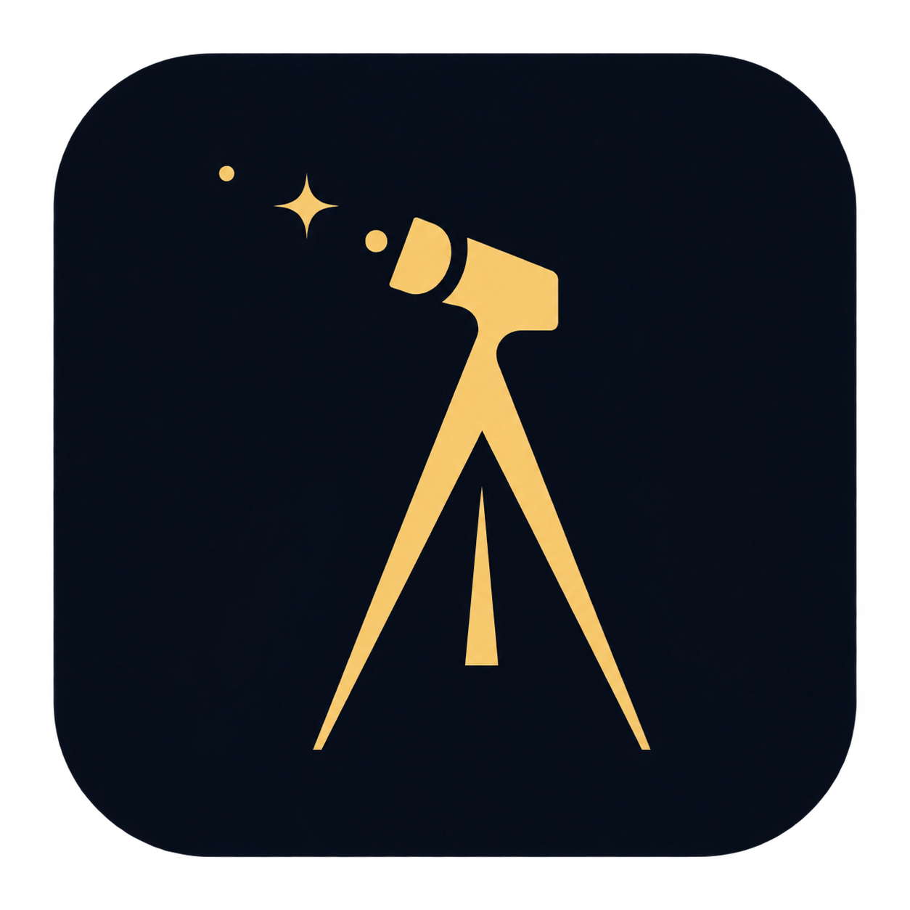
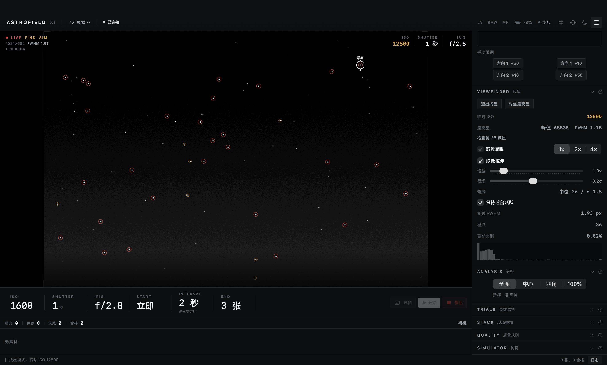
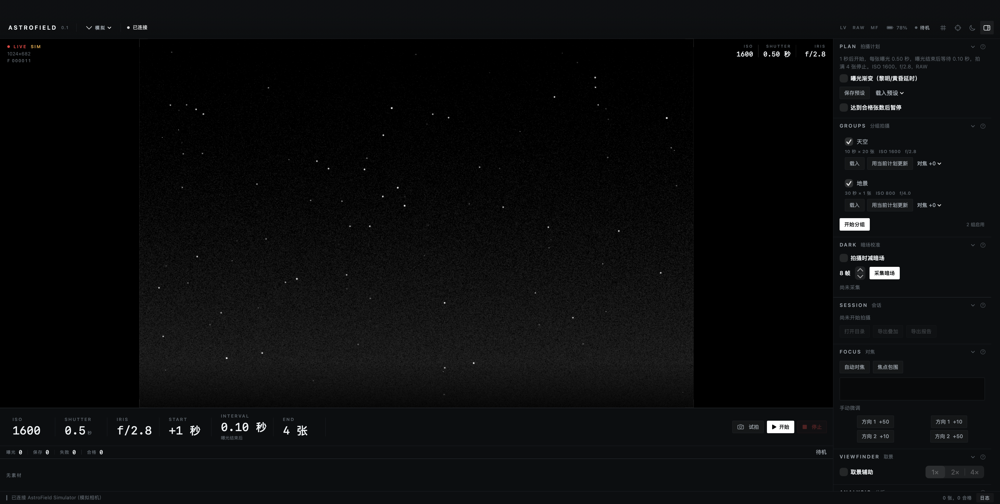
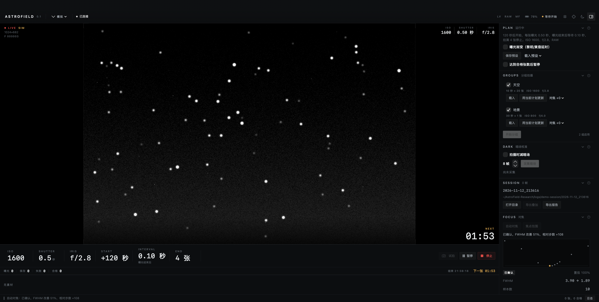
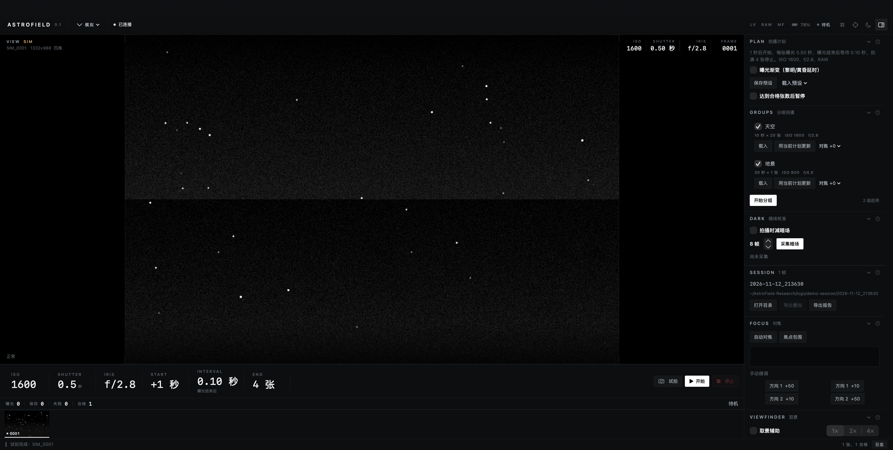
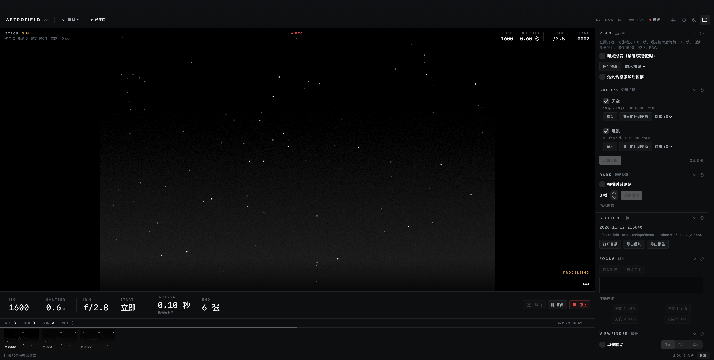

<p align="center">
  
</p>

<h1 align="center">AstroField</h1>

<p align="center"><a href="README.md">简体中文</a> · <strong>English</strong></p>

AstroField is a macOS app for photographing star fields and the Milky Way. Connect a Nikon camera over USB to find a star, fine-tune focus and shoot a sequence. During a shoot you can inspect stars in the corners of each frame or watch a stack build up. All image processing runs on your Mac.



## Run the app

You'll need macOS 14 or later and a Swift 5.10 or newer toolchain from Xcode or the Xcode Command Line Tools.

```bash
git clone https://github.com/sergeymeng/AstroField.git
cd AstroField
swift run AstroField
```

The app starts with a simulated camera. To inspect your own photos, select photo playback from the source menu at the top. To connect a camera, set its USB mode to MTP/PTP, quit any transfer software using it, then select **Nikon USB** from the same menu.

To build a locally signed release that opens from Finder, run the following commands.

```bash
./scripts/build_app.sh
open dist/AstroField.app
```

## Find a star and focus

1. In **VIEWFINDER**, turn on the preview stretch (取景拉伸). Raise the gain (增益) to bring out faint stars and adjust the black point (黑场) to set the sky brightness. Star measurements and focus use the original decoded camera JPEG.
2. Select **找星模式** (Find stars). AstroField temporarily sets ISO to 12800, circles detected stars and marks the brightest one with a crosshair. If your lens supports MFDrive, select **对焦最亮星** to focus on that star. The panel shows its full width at half maximum (FWHM) in pixels.
3. If LiveView still shows no stars, AstroField takes a 2-second JPEG at ISO 12800 for the viewfinder only. If the test frame is also blank, the panel reads **未检测到星点** (No stars detected). Select **退出找星** to restore your previous capture settings.

If the Nikon USB session drops, AstroField pauses the running sequence and displays the reconnection attempt number. LiveView reopens when the connection returns. After five failed attempts, the log at the bottom shows the last error. The **保持后台活跃** option keeps the app polling the camera while the display sleeps.

## Capture and processing

| Task | In the app |
| --- | --- |
| Shoot a sequence | Start immediately, after a countdown or at a scheduled time. Set a start-to-start interval or a delay after each exposure. Pausing or stopping lets the current exposure finish. |
| Choose an exposure | In manual mode, use 星空 Auto to estimate a shutter limit for trailing from the focal length. The app checks the sky background, stars and highlights in test shots before applying settings to the plan. You can also compare shutter speeds or apertures yourself. |
| Inspect frames | Open NEF, JPEG, PNG or TIFF files. Switch between the full image, centre, corners and native-pixel crops. Compare FWHM across frames and use quality thresholds to trigger an alert, pause or refocus. |
| Calibrate with dark frames | Fit the lens cap and capture a set of darks in the DARK panel at the ISO and exposure time used for your lights. AstroField averages them into a master dark for subtraction during analysis and stacking. |
| Stack and export | Preview a star-aligned stack or fixed-camera star trails while shooting. Afterwards, use SESSION to align the session's light frames by translation and export a 16-bit TIFF and a PNG preview. |

Sessions are saved in timestamped folders under `~/Pictures/AstroField/`. A JSON sidecar records each frame's settings and quality metrics. For camera NEFs, it points to the original file. Use SESSION to export a CSV or JSON report for the whole shoot.

## Cameras and RAW decoding

Nikon USB control uses macOS ImageCaptureCore and PTP. Indoor Z7 II tests cover connection, LiveView, NEF download, short sequences and camera display control. Night-sky preview stretch, star finding and automatic reconnection are pending Z7 II field tests. The Z8 is a target model awaiting hardware testing. [Z7 II test record (Chinese)](docs/Z7II_APP_ACCEPTANCE.md)

Core Image decodes NEFs by default. To use linear brightness values for measurements and dark calibration, install LibRaw with Homebrew and rebuild. The optional MAID command-line diagnostics use the Nikon SDK.

<details>
<summary>More screenshots from the simulator</summary>






</details>

## Development

```bash
swift test
swift run afspike selftest
```

The SwiftUI app lives in `Sources/AstroField`. Capture planning, focus and image processing are in `Sources/AstroFieldKit`. ImageCaptureCore and PTP communication are in `Sources/AFSpikeCore`. The developer and architecture guides are in Chinese. [Development guide](docs/DEVELOPMENT.md) · [Architecture](docs/ARCHITECTURE.md)
