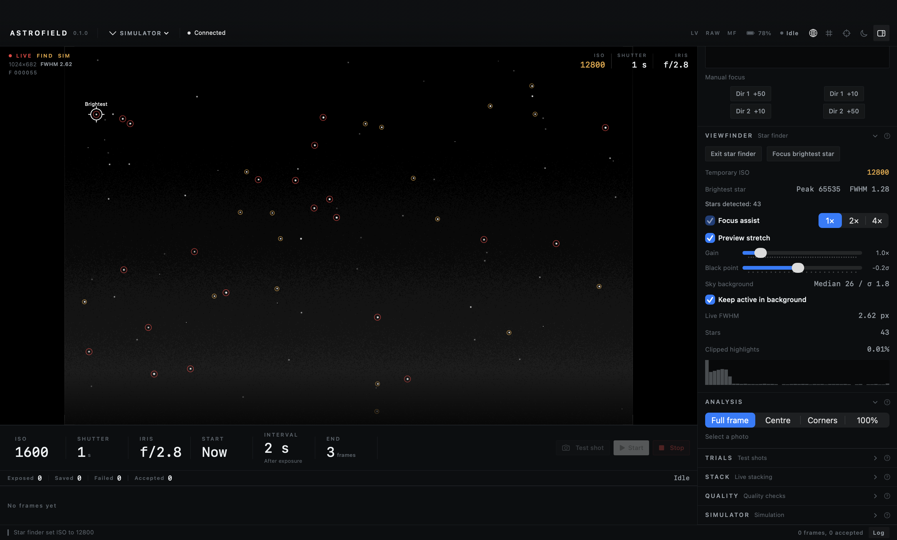

# AstroField

[简体中文](README.md) · English

AstroField lets you focus a USB-connected Nikon on a star and shoot a sequence from your Mac. As each NEF comes in, you can open its corner crops and check whether the stars are starting to trail.



*The simulator in star-finding mode. The crosshair marks the brightest star. The panel on the right shows its peak intensity and full width at half maximum (FWHM).*

## Run on macOS

[Download AstroField 0.1.0 for Mac](https://github.com/sergeymeng/AstroField/releases/download/v0.1.0/AstroField-0.1.0-macOS-universal.zip). Unzip it and drag AstroField to Applications. The app runs on Intel and Apple silicon Macs with macOS 14 or later.

Use the globe at the top right of the window to choose English, 简体中文 or Follow System. The window updates immediately and remembers your choice for the next launch.

To run from source, install Swift 5.10 or newer.

```sh
git clone https://github.com/sergeymeng/AstroField.git
cd AstroField
swift run AstroField
```

The simulator opens on launch, so you can try a sequence straight away. To use a camera, set its USB mode to MTP/PTP and select **Nikon USB** from the source menu at the top of the window. For a Finder app, run `./scripts/build_app.sh` and open `dist/AstroField.app`.

## When the viewfinder looks like noise

On a night shoot on 13 November, stars were barely visible in the LiveView JPEGs from the Z7 II. The **VIEWFINDER** panel lets you raise the gain and set the black point to bring faint stars out of the background. Focus measurements use the original JPEG.

Select **Find stars** to switch temporarily to ISO 12800. If LiveView still shows no stars, AstroField takes a single 2-second JPEG for framing and keeps it out of the capture sequence. With an MFDrive lens, **Focus brightest star** focuses on the brightest star. Select **Exit star finder** when you're ready to return to your capture settings.

## After the shoot

Open **SESSION** to align the frames on the stars and export a 16-bit TIFF. For trails, use the fixed-camera preview. Each session has a folder under `~/Pictures/AstroField/` with exposure settings and quality measurements for each frame. You can export the frame list as a CSV.

Indoor Z7 II tests covered 1024 × 680 LiveView, NEF downloads and a three-frame sequence. The preview stretch, star finder and automatic USB reconnection still need a field test. The Z8 hasn't been tested. [Z7 II camera notes and test procedure (Chinese)](docs/Z7II_APP_ACCEPTANCE.md)

[Build and USB diagnostics (Chinese)](docs/DEVELOPMENT.md) · [Camera and image processing code (Chinese)](docs/ARCHITECTURE.md) · [Screenshots](docs/screenshots/)
