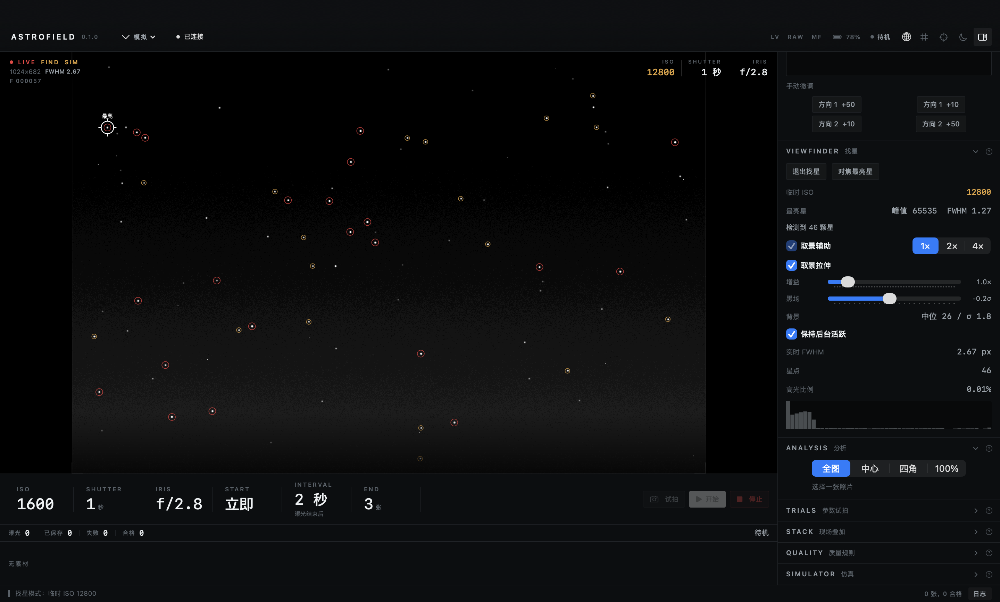

# AstroField

简体中文 · [English](README.en.md)

把 Nikon 接到 Mac 上，在大屏幕上找星、对焦，再让相机按间隔拍下整组星野。拍摄中可以点开刚下载的 NEF，放大四角，看边缘的星点有没有拖长。



*模拟相机取景。十字标记指向最亮星，右侧显示这颗星的峰值和半高全宽（FWHM）。*

## 在 Mac 上运行

需要 macOS 14 或更新版本，以及 Swift 5.10 或更新版本的工具链。

```sh
git clone https://github.com/sergeymeng/AstroField.git
cd AstroField
swift run AstroField
```

启动后就能在模拟星空里试拍。接真机时，将相机的 USB 模式设为 MTP/PTP，在窗口顶部的来源菜单选择 **Nikon USB**。要从 Finder 启动，可运行 `./scripts/build_app.sh`，然后打开 `dist/AstroField.app`。

## 取景器里只有噪点时

11 月 13 日夜拍时，Z7 II 传回的 LiveView JPEG 几乎看不出星点。在 **VIEWFINDER** 里调高「增益」、压低天空背景，可以把接近背景亮度的星点显出来。对焦仍用原始 JPEG 测量。

点击「找星模式」会把 ISO 暂时调到 12800。如果实时画面里一直找不到星，相机会单独拍一张 2 秒 JPEG 帮你构图。这张试拍只留在取景器里。镜头支持 MFDrive 时，可以点「对焦最亮星」。点「退出找星」就回到之前的拍摄设置。

## 拍完一组以后

在 **SESSION** 里可以按星点对齐这组照片，导出 16 位 TIFF。想看星轨，就用固定机位的星轨预览。会话记录在 `~/Pictures/AstroField/`，每张都有对应的曝光参数和质量指标，也可以整组导出 CSV。

Z7 II 的室内记录包含 1024 × 680 实时取景、单张 NEF 下载和三张短序列。夜空下的取景拉伸、找星和 USB 自动重连还要带机复测，Z8 也尚未实测。[Z7 II 实拍记录与复测方法](docs/Z7II_APP_ACCEPTANCE.md)

[构建、模拟器与 USB 诊断](docs/DEVELOPMENT.md) · [相机与图像处理代码](docs/ARCHITECTURE.md) · [更多界面截图](docs/screenshots/)
