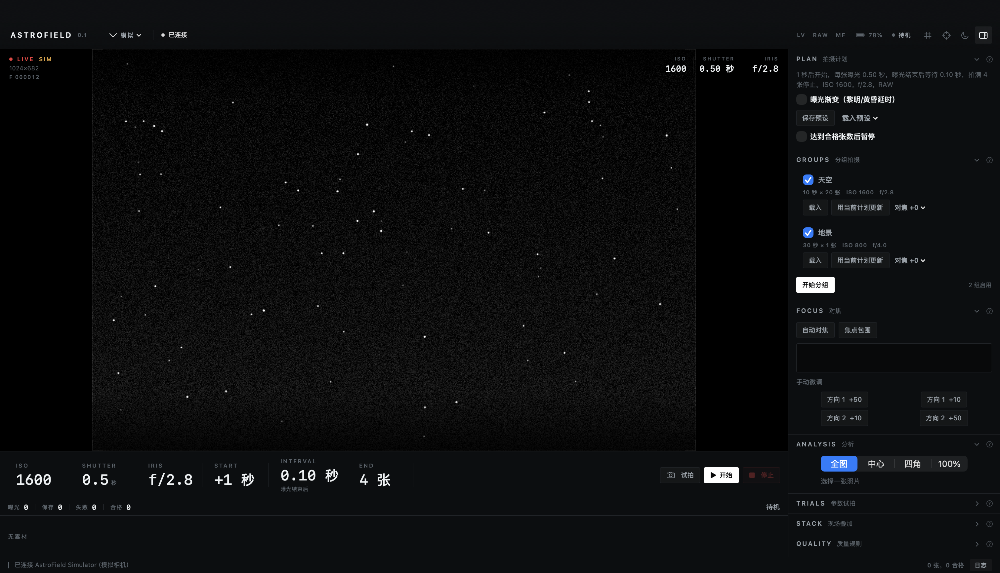
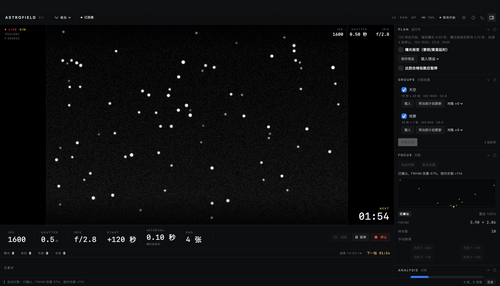
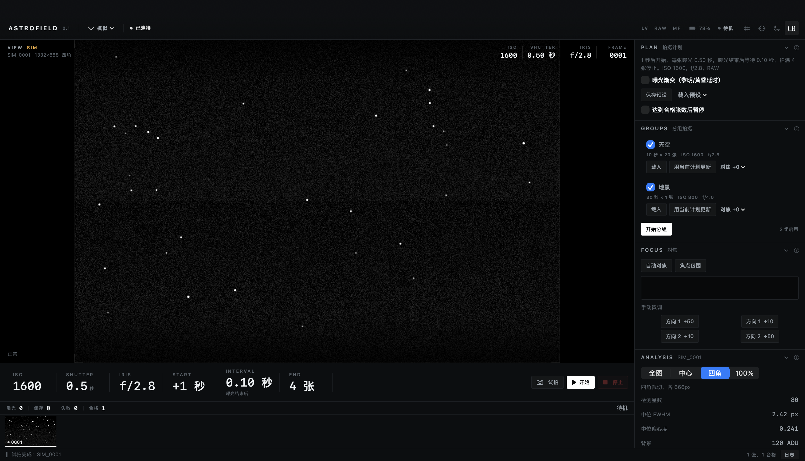
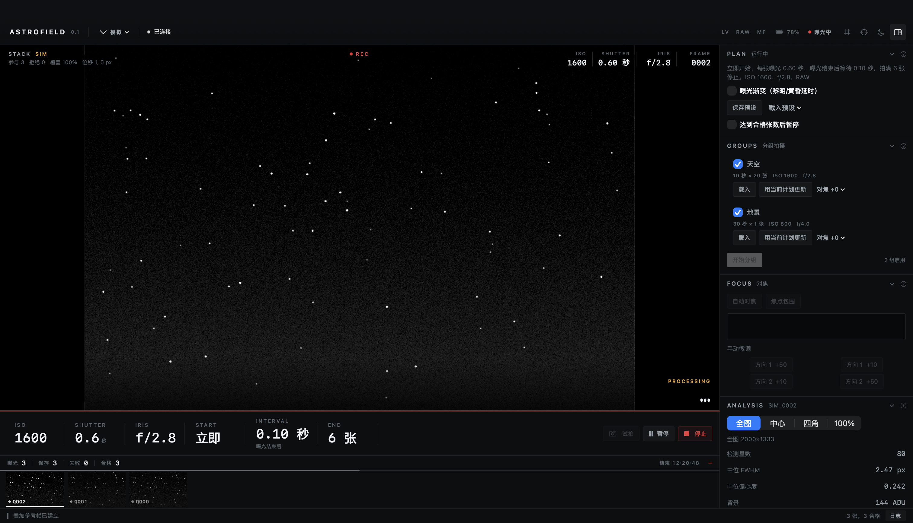

# AstroField

在 Mac 上设置拍摄计划、对焦和检查星空照片。

AstroField 面向使用相机、镜头和三脚架拍银河与星野的摄影师。把曝光时间、拍摄间隔和张数设好，就可以在同一个窗口里看拍摄进度、放大星点、比较试拍结果。应用使用 SwiftUI，照片处理在本机完成。



截图来自内置模拟相机。没有连接设备也可以运行应用、测试拍摄计划和对焦流程。

## 可以做什么

- **定时拍摄。** 立即开始、倒计时或指定时间开始；支持固定开拍间隔和曝光结束后等待两种节奏。可以保存预设、暂停续拍，按张数或时间结束。
- **对焦与试拍。** 自动检测星点，执行对焦搜索并显示曲线；也可以手动微调，比较不同快门、光圈或包围曝光的照片。
- **检查照片。** 打开 NEF、JPEG、PNG 和 TIFF，查看整图、中心、四角及原始像素裁切。显示星点大小、形状、背景和直方图，支持前后对比。
- **跟踪拍摄变化。** 查看逐张指标，设置质量提醒、暂停条件和重对焦规则。
- **叠加预览。** 将星点平移对齐后累积显示，也提供固定机位的星轨预览。
- **离线演练。** 模拟器可以改变焦点、星点移动、天空亮度和云量，注入拍摄错误；照片回放可以使用自己的素材。

天空／地景分组、焦点包围、曝光渐变和亮轨迹候选检测也已接入界面，仍在验证中。

## 运行

需要 macOS 14 或更新版本，以及提供 Swift 5.10 或更新工具链的 Xcode / Command Line Tools。

```bash
git clone https://github.com/sergeymeng/AstroField.git
cd AstroField
swift run AstroField
```

默认连接模拟相机。顶部来源菜单可以切换为照片回放或 Nikon USB；点击下方参数可以编辑拍摄计划，右侧面板提供对焦、分析、试拍和叠加操作。

也可以构建一个本地 `.app`：

```bash
./scripts/build_app.sh
open dist/AstroField.app
```

当前提供源码构建，生成的应用使用本地临时签名，尚未做 Apple 公证。

## 相机支持

首批目标机型是 Nikon Z7 II 和 Z8。应用通过 macOS 的 ImageCaptureCore 发送 PTP 命令，**正常构建和运行不需要下载 Nikon SDK**。

Z7 II 的底层连接、LiveView、RAW 下载、Bulb 和镜头调焦指令已有室内实测记录。应用内完整拍摄流程仍需复验，Z8 尚未实测。自动对焦、质量规则和参数试拍的验证目前以模拟数据为主，还没有完成真实星空验收。

连接时将相机 USB 模式设为 MTP/PTP，并退出正在占用相机的其他程序。不同机身、固件和镜头的可用操作可能不同。

## 使用时需要知道

- NEF 通过 Core Image 解码。直方图和星点指标来自解码后的图像，不能当作传感器原始通道测量；全图快速分析与原始像素裁切也使用不同分辨率。
- 自动对焦搜索目前优先使用 LiveView 测量，结束后补拍一张照片检查。实际镜头上的精度仍需验证。
- 现场叠加是低分辨率预览，目前只处理平移，没有处理旋转、视差或天空与地景的分离。
- “停止”会停止后续调度，当前曝光仍会完成。
- 星图解析、全景接片和地景焦点合成尚未实现。

<details>
<summary>更多界面截图（模拟数据）</summary>

自动对焦：



四角检查：



叠加预览：



</details>

## 开发

```bash
swift test
swift run afspike selftest
```

`Sources/AstroField` 是 SwiftUI 界面，`AstroFieldKit` 包含模拟器、拍摄计划、对焦和图像处理，`AFSpikeCore` 提供 ImageCaptureCore / PTP 底层。`afspike` 是独立的命令行诊断工具。

[开发说明](docs/DEVELOPMENT.md)包含回放、截图和可选 Nikon MAID 后端的配置方法。[架构说明](docs/ARCHITECTURE.md)记录了相机接口与图像处理流程。

Nikon SDK 文件、实拍原片和本地测试日志不包含在仓库中。
