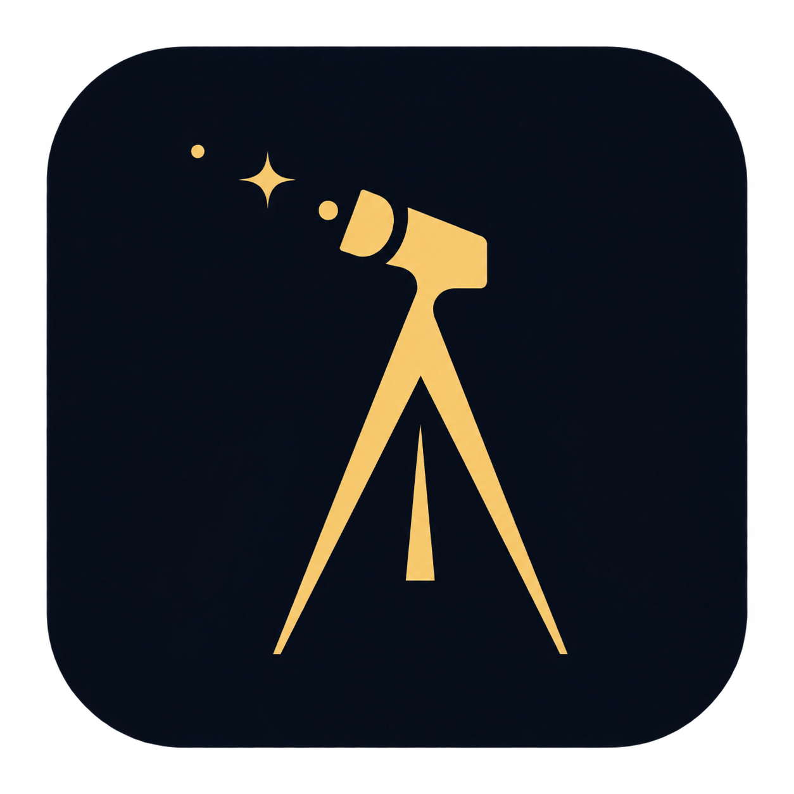
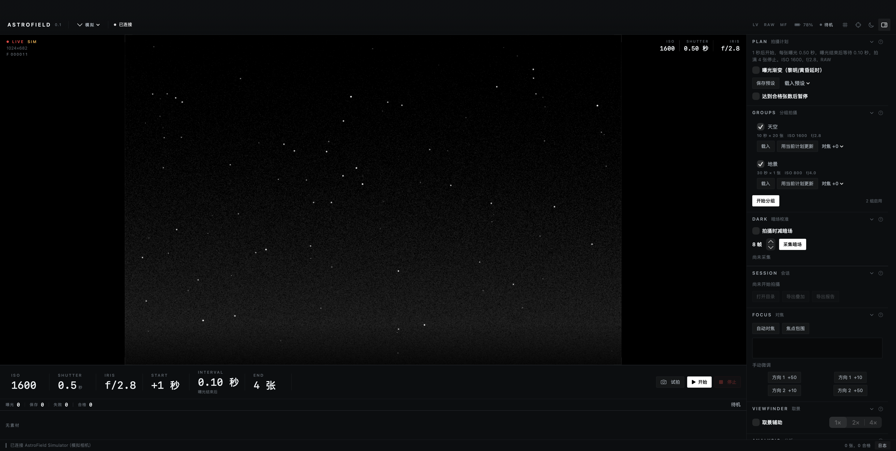
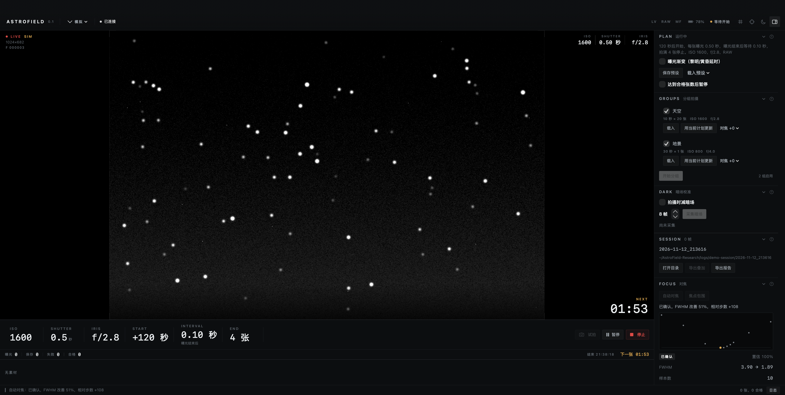
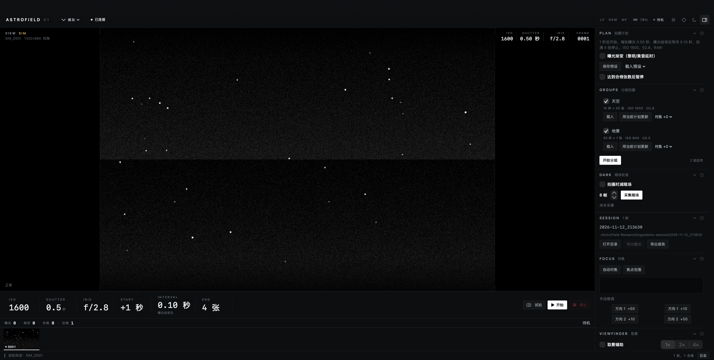
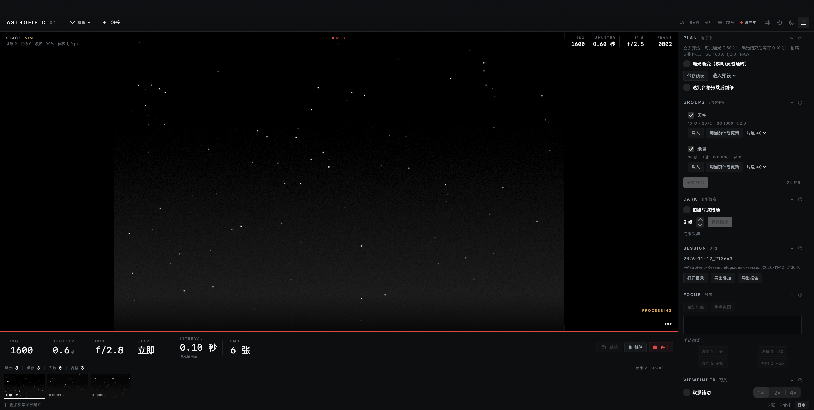

<p align="center">
  
</p>

<h1 align="center">AstroField</h1>

<p align="center"><strong>简体中文</strong> · <a href="README.en.md">English</a></p>

AstroField 是一款在 Mac 上拍摄星野和银河的工具。用 USB 连接 Nikon 相机后，可以在取景画面上找星、微调焦点，再按设定的间隔拍一组照片。拍摄中可以放大检查四角的星点，也可以预览叠加效果。照片在本机处理。


## 运行

需要 macOS 14 或更新版本，以及 Swift 5.10 或更新版本的工具链（Xcode 或 Xcode Command Line Tools）。

```bash
git clone https://github.com/sergeymeng/AstroField.git
cd AstroField
swift run AstroField
```

首次启动会打开模拟相机。要用自己的照片，打开顶部来源菜单，选择照片回放。要连接相机，将机身 USB 模式设为 MTP/PTP，退出占用相机的传输软件，再从来源菜单选择 **Nikon USB**。

要生成可从 Finder 启动的本地应用，运行以下命令。脚本会生成带本地临时签名的 Release 版本。

```bash
./scripts/build_app.sh
open dist/AstroField.app
```

## 找星与对焦

1. 在 **VIEWFINDER** 打开「取景拉伸」。调高「增益」可以看清较暗的星点，用「黑场」调整天空背景的亮度。星点测量和对焦使用相机原始 JPEG 解码帧。
2. 点击「找星模式」。AstroField 暂时将 ISO 调到 12800，圈出检测到的星点，并用十字标出最亮星。支持 MFDrive 的镜头可以点击「对焦最亮星」，面板会显示星点的半高全宽（FWHM），单位为像素。
3. 如果实时取景持续找不到星，AstroField 会以 ISO 12800 拍一张 2 秒 JPEG，单独用于取景。画面里仍没有星点时，面板显示「未检测到星点」。点击「退出找星」恢复进入前的拍摄设置。

Nikon USB 会话中断时，AstroField 会暂停正在运行的序列，状态栏显示「重连中 n/5」。连接恢复后，状态栏显示「已恢复」，实时取景自动重开。连续五次失败后，可在底部日志查看最后一次错误。「保持后台活跃」可让应用在显示器休眠期间继续轮询相机。

## 拍摄与处理

| 要做的事 | 操作 |
| --- | --- |
| 拍一组曝光 | 设置立即、倒计时或定时开始。可以固定每张的开拍间隔，也可以让相机在每次曝光后等待。暂停或停止时，当前曝光会先完成。 |
| 选择曝光 | 在 M 档使用「星空 Auto」。应用根据焦距估算拖线上限，再用试拍检查背景亮度、星点和高光。参数通过检查后写入计划。也可自行比较不同快门或光圈的试拍。 |
| 检查照片 | 打开 NEF、JPEG、PNG 或 TIFF，在整图、中心、四角和原始像素之间切换。用 FWHM 比较焦点变化，按逐张指标设置质量提醒、暂停或重对焦。 |
| 采集暗场 | 盖上镜头盖，在 DARK 面板按拍摄所用的 ISO 和曝光时间采集多帧暗场。应用合成主暗场，供后续分析和叠加减除热像素与暗电流。 |
| 叠加与导出 | 拍摄时可预览星点对齐或固定机位的星轨效果。拍完后在 SESSION 面板叠加本次拍摄的亮场，按星点平移对齐，导出 16 位 TIFF 和 PNG 预览。 |

会话默认保存在 `~/Pictures/AstroField/` 下的时间戳目录。每张照片的 JSON 记录包含拍摄参数和质量指标。对于实拍 NEF，记录指向原片位置。SESSION 面板可导出整组拍摄的 CSV 或 JSON 报告。

## 相机与 RAW 解码

Nikon USB 连接使用 macOS 的 ImageCaptureCore 和 PTP。Z7 II 已在室内实测连接、实时取景、NEF 下载、短序列和机身关屏。夜空取景拉伸、找星和自动重连待 Z7 II 现场验证。Z8 是目标机型，尚待实测。[Z7 II 验收记录](docs/Z7II_APP_ACCEPTANCE.md)

NEF 默认通过 Core Image 解码。安装 Homebrew 的 LibRaw 后重新构建，可使用线性亮度做测量和暗场校准。Nikon SDK 用于可选的 MAID 命令行诊断。

<details>
<summary>更多模拟相机截图</summary>






</details>

## 开发

```bash
swift test
swift run afspike selftest
```

SwiftUI 界面位于 `Sources/AstroField`，拍摄计划、对焦与图像处理位于 `Sources/AstroFieldKit`，ImageCaptureCore 和 PTP 通信位于 `Sources/AFSpikeCore`。[开发说明](docs/DEVELOPMENT.md) · [架构说明](docs/ARCHITECTURE.md)
